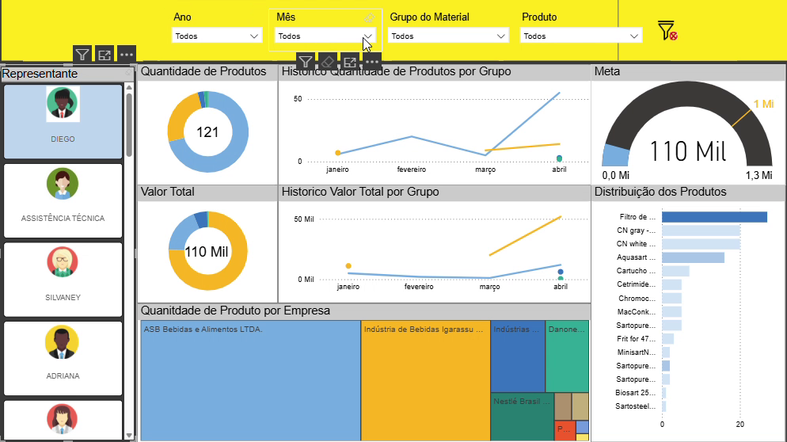

# Sellers' Performance

The full write-up for this project is on the [repository's main page](../README.md).

- `Dashboard.pbix`: the Power BI report
- `dashboard_walkthrough.mp4`: screen recording of the dashboard in use ([watch it here](https://andrescarton.github.io/Power-BI/))
- `sales_analysis.ipynb`: data cleaning, exploratory analysis and the CatBoost model
- `Project Performance.pptx`: the project presentation
- `images/`: screenshots used in the README

