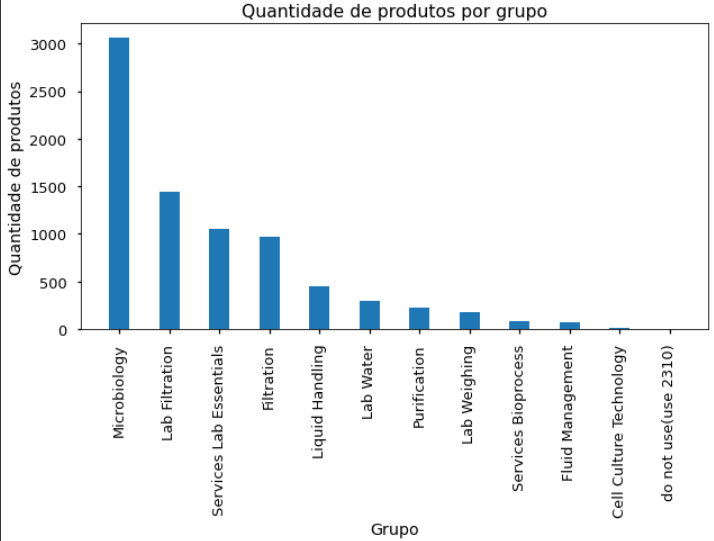
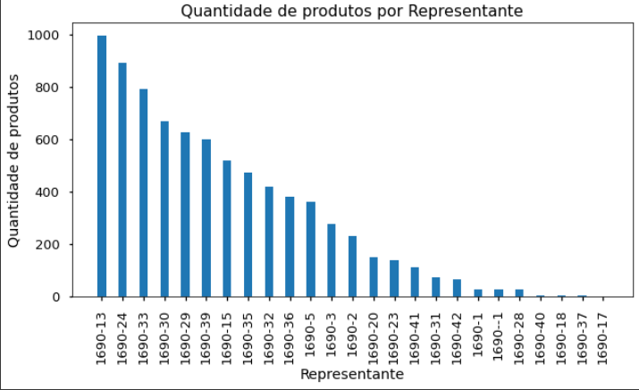

# Sellers' Performance

A Power BI dashboard for sales managers to see how each sales representative is doing: how many products they sold, how much revenue that brought in, how it changed month to month and how close they are to their target.

## What the dashboard shows

- Number of products sold and total sales value, split by product group
- Monthly history of both, per group
- Progress against the sales target (gauge)
- Which products sell the most, and which customers buy the most
- Filters by year, month, product group and product, plus a card per sales rep to drill into one person

## How I got there

The data came as two tables: 3,543 sales records with 29 columns, and a table with the reps' names. In `sales_analysis.ipynb` I:

1. Cleaned the data. Seven columns were almost entirely empty, and only two records had missing values.
2. Checked for outliers with z-scores (55 records) and boxplots.
3. Explored sales by product group, by rep and by customer before deciding what went into the dashboard.
4. Tried a CatBoost regression to forecast future sales of each product per rep, as a starting point for stock and campaign planning.

| Products sold by group | Products sold by rep |
|---|---|
|  |  |

## Files

- `sales_analysis.ipynb`: data cleaning, exploratory analysis and the CatBoost model
- `Project Performance.pptx`: the presentation of the project, with the full process
- `images/`: screenshots of the dashboard and charts

This was a course project. The original Power BI link has expired. A new screenshot of the dashboard is coming soon.
